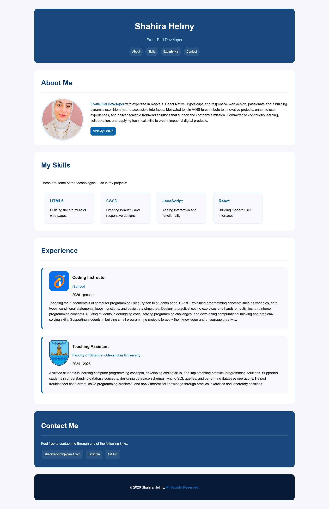

# Assignment 1 - Personal Portfolio

## About the Project

A simple personal portfolio website built as the first assignment in the Web Development Track. This project focuses on practicing and applying the HTML and CSS concepts learned during the track.

## Live Demo

[View Live Website](https://shahirra.github.io/assignment-1-personal-portfolio/)

## Screenshot

## Website Sections

- **Header:** Displays my name, professional position, and navigation links to different sections of the website.
- **About Me:** Introduces me through a short personal description.
- **Skills:** Showcases my technical skills.
- **Experience Timeline:** Highlights my work experience, positions, and a brief description of each experience.
- **Contact Me:** Provides links to my email, LinkedIn, GitHub, and other contact methods.

## Technologies Used

- HTML5
- CSS3

## Learning Objectives

- Practice structuring web pages using HTML.
- Apply CSS styling and layout techniques.
- Create navigation links between page sections.
- Organize content into clear and structured sections.
- Build a simple personal portfolio using the concepts learned so far.
